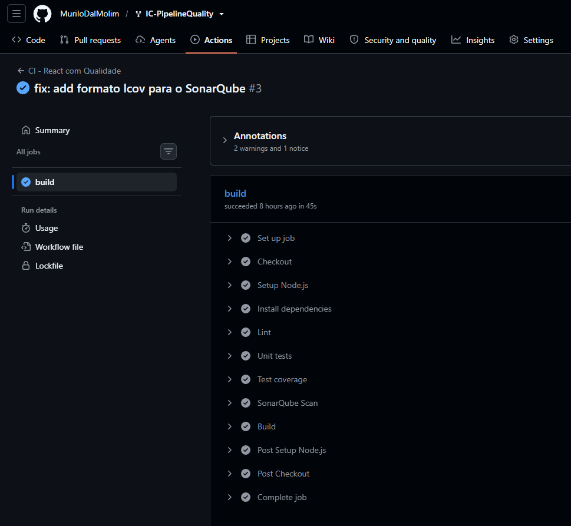
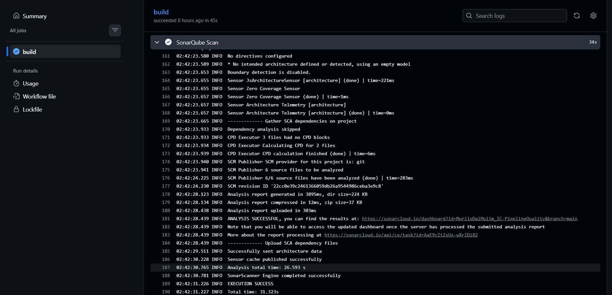
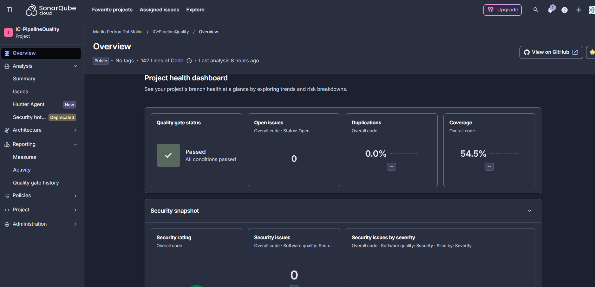
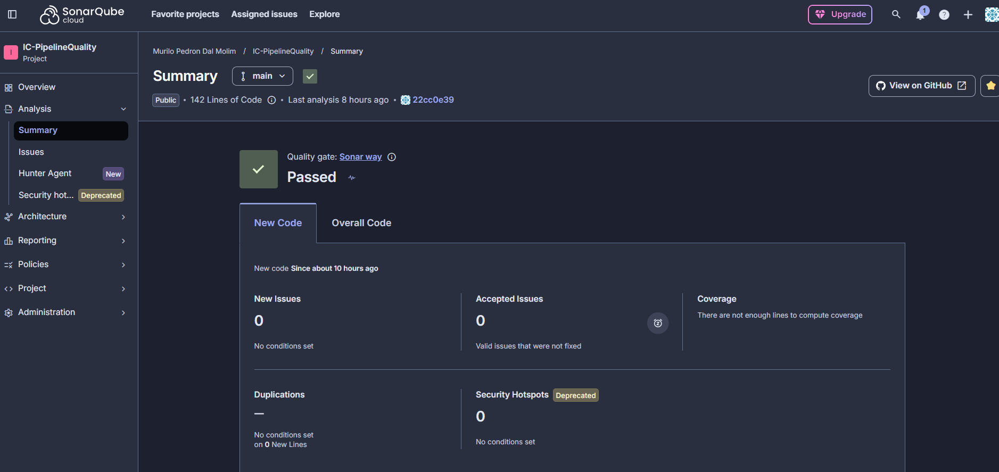

# Catálogo de Tecnologias — Qualidade no Pipeline

Projeto React/Vite usado na aula de **Qualidade de Software no Pipeline**. A aplicação possui uma lista com 30 tecnologias e uma busca por nome, categoria ou descrição.

## O que foi adicionado nesta versão

- ESLint com regras de qualidade (`no-unused-vars`, `no-console` e `eqeqeq`).
- Teste unitário com Vitest para a função de busca.
- Cobertura com `@vitest/coverage-v8`, gerando `coverage/lcov.info`.
- Integração com SonarQube por `SonarSource/sonarqube-scan-action@v7`.
- Pipeline: Checkout → Setup → Install → Lint → Test → Coverage → SonarQube → Build.

## Executar localmente

```bash
npm install
npm run dev
```

## Verificações de qualidade

```bash
npm run lint
npm test
npm run coverage
npm run build
```

## Teste unitário

A lógica da busca foi isolada em `src/search.js`. O arquivo `src/search.test.js` verifica, inicialmente, dois comportamentos:

1. busca por um termo (`react`);
2. busca vazia retorna a lista completa.

Isso permite que os alunos adicionem novos casos durante a aula, por exemplo: busca por categoria, descrição, termo inexistente e diferenças entre maiúsculas/minúsculas.

## ESLint

As regras ficam em `eslint.config.js`.

Exemplo:

```js
rules: {
  'no-unused-vars': 'error',
  'no-console': 'error',
  eqeqeq: 'error',
}
```

Para provocar uma falha no pipeline, adicione temporariamente um `console.log()` ao código ou declare uma variável sem utilizá-la.

## SonarQube

O arquivo `sonar-project.properties` define o projeto e informa ao SonarQube onde encontrar o relatório LCOV:

```properties
sonar.javascript.lcov.reportPaths=coverage/lcov.info
```

Para que esse arquivo seja gerado, o script `coverage` do `package.json` utiliza o reporter `lcov` do Vitest:

```json
"coverage": "vitest run --coverage --coverage.reporter=text --coverage.reporter=lcov"
```

A análise é feita no **SonarQube Cloud**. Antes de executar o workflow, crie no repositório GitHub o seguinte **Actions secret**:

- `SONAR_TOKEN`: token de análise gerado no SonarQube Cloud.

No SonarQube Cloud não é necessário o secret `SONAR_HOST_URL`, usado apenas em servidores próprios.

Em `sonar-project.properties`, `sonar.organization` e `sonar.projectKey` correspondem à organização e ao projeto criados no SonarQube Cloud:

```properties
sonar.organization=murilodalmolim
sonar.projectKey=MuriloDalMolim_IC-PipelineQuality
```

A análise automática do SonarQube Cloud foi desativada (_Administration → Analysis Method_), para que a análise seja executada pelo pipeline.

> O workflow realiza a análise no SonarQube, mas não espera o resultado do Quality Gate. Isso permite apresentar a análise primeiro e adicionar o bloqueio pelo Quality Gate como evolução posterior da aula.

## Pipeline

```text
Checkout
   ↓
Setup Node.js
   ↓
Install
   ↓
Lint
   ↓
Unit tests
   ↓
Coverage
   ↓
SonarQube
   ↓
Build
```

## Evidências da análise de qualidade

### Pipeline



### Etapa do SonarQube no pipeline



### SonarQube



### Quality Gate


